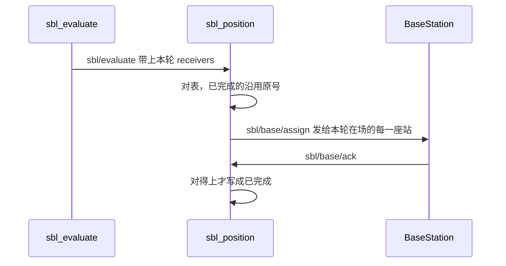

# 基站编号分配

`sbl_position` 负责分配和记录站号。基站侧负责收下站号并回应答。基站侧不在本仓库实现。

一次 `sbl/evaluate` 的 `layout.receivers` 就是本轮在场的基站，有几座就是几座。不另发一条“一共几个”的消息。



Broker 与定位程序相同：`127.0.0.1:1883`，MQTT 3.1.1，无 TLS、无用户名密码。QoS 0，不保留。

| 方向 | 主题 | 谁发 |
| --- | --- | --- |
| 分配请求 | `sbl/base/assign` | `sbl_position` |
| 完成应答 | `sbl/base/ack` | 基站侧 |

载荷是 UTF-8 JSON，一个对象一条消息，无换行。键的先后不参与判读。

## 分配请求

`schema` 固定为 `sbl.base_assign.v1`。每座在场的站单独一条，不把多座站打进同一条。

```json
{"schema":"sbl.base_assign.v1","receiver_id":"rx-1","name":"Rx-1","base_id":1}
```

| 字段 | 类型 | 含义 |
| --- | --- | --- |
| `schema` | string | 固定 `sbl.base_assign.v1` |
| `receiver_id` | string | 评估报文 `layout.receivers[].id`，不含空格 |
| `name` | string | 评估报文里的 `name`。没有名字时为空字符串 |
| `base_id` | int | 本工程分配的站号，从 1 起 |

基站侧订阅 `sbl/base/assign`。`receiver_id` 对得上自己的站时，保存 `base_id`，再发应答。对不上的请求忽略，不回应答。

本轮 `layout.receivers` 里的每一座站都会收到分配请求，已完成的站也发原来的号。基站重启后靠这一条把站号显示出来，并回 `already_set`。评估报文大约每秒一条，所以同一座站会反复收到同一个 `base_id`。重复请求不要改号。

## 完成应答

基站侧发布到 `sbl/base/ack`。`schema` 固定为 `sbl.base_ack.v1`。

```json
{"schema":"sbl.base_ack.v1","receiver_id":"rx-1","base_id":1,"result":"accepted"}
```

| 字段 | 类型 | 含义 |
| --- | --- | --- |
| `schema` | string | 固定 `sbl.base_ack.v1` |
| `receiver_id` | string | 与请求里的 `receiver_id` 相同 |
| `base_id` | int | 基站实际保存的站号 |
| `result` | string | `accepted`、`already_set` 或 `rejected` |

`accepted` 表示这次新收下。`already_set` 表示基站里已经是同一个号。这两项都算分配完成。`rejected` 表示拒绝，站号保持待确认，下次仍发原来的号。

`receiver_id` 必须在编号表里，且 `base_id` 必须等于表里这座站的号。对不上时不改状态。

可以用下面的命令看分配请求，或代基站回一条应答：

```text
mosquitto_sub -h 127.0.0.1 -p 1883 -t sbl/base/assign -V mqttv311
mosquitto_pub -h 127.0.0.1 -p 1883 -t sbl/base/ack -V mqttv311 -m '{"schema":"sbl.base_ack.v1","receiver_id":"rx-1","base_id":1,"result":"accepted"}'
```

## 编号规则

编号表在 `config/base_ids.conf`。程序启动时读取。文件不存在就从 `next_id 1` 开始。

```text
next_id 4
1 rx-1 confirmed
2 rx-2 pending
3 rx-3 confirmed
```

`next_id` 是下一个可分配的号。每一行站记录是 `base_id`、`receiver_id`、状态。状态是 `confirmed` 或 `pending`。`#` 开头的行是注释。

第一次见到某座站时，按该条 `layout.receivers` 的数组顺序占用当前 `next_id`，状态为 `pending`，然后 `next_id` 加 1。号写入文件后不再修改，也不回收。这座站以后换位置、或在数组里的次序变了，仍然是原来的号。

后来新出现的 `receiver_id` 才取新的 `next_id`。暂时不在报文里的站留在表里，不把后面的站往前顶。

认站只用 `receiver_id`。坐标只用来解算。

## 解算用哪些号

三站固定用已完成的 1、2、3。1 是 A，2 是 B，3 是 C。

双站不固定 1 和 2。已完成的站里，坐标不是全 0、斜距不是 0，才算本轮有效。有多座有效站时，取 Y 坐标之差的绝对值最大的两座，站号较小的是 A，较大的是 B。Y 差相同则取站号较小的那一对。某一座本轮没有斜距、斜距为 0，或坐标全为 0 时，不进入这次比较。有效站不足两座时不发 `sbl/position`。

斜距仍用 `receiver_id` 到 `ranges` 里配对，只用 `used` 和 `los` 都为真的斜距。还没完成的站不参与这次选择。

三站时，某一号还是 `pending`，或本轮没有这座已完成站的斜距，本条不发 `sbl/position`。终端打印缺的是哪一座。分配请求照常发。
